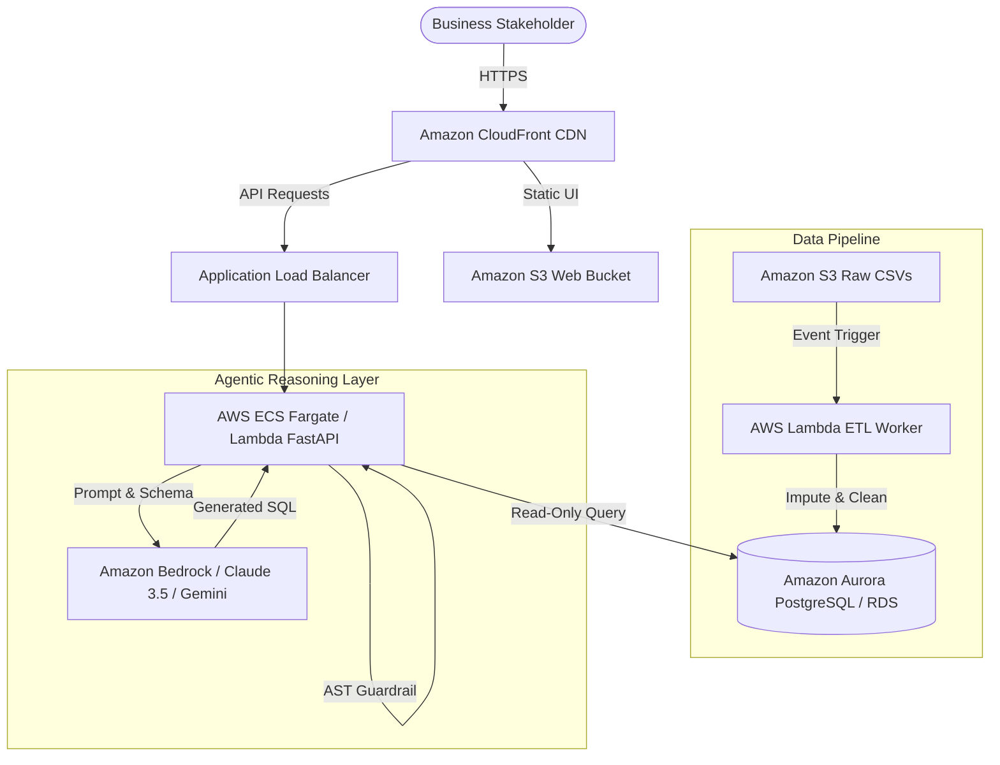

# Core Technical Concepts Cheatsheet
## Deep-Dive Reference for Candidate Interview Defense

**Candidate:** Abdul Rasool  
**Role:** Graduate Engineer Trainee (Python with Generative AI Engineer) — RSG  
**Reporting Manager / Evaluator:** Jeevan Kumar, RSG, Hyderabad  
**Focus:** Generative AI, Agentic Workflows, Retrieval Architectures, Cloud Scaling  

---

## 1. Agentic AI vs. Standard Generative AI

| Dimension | Standard Generative AI | Agentic AI (Our Implementation) |
|---|---|---|
| **Execution Pattern** | One-shot prompt $\to$ response. No intermediate steps. | Multi-step reasoning loops (Observe $\to$ Plan $\to$ Act $\to$ Reflect). |
| **Tool Integration** | None. Model attempts to calculate and synthesize internally. | External tool delegation (e.g., executing SQL in SQLite engine). |
| **Error Handling** | Blindly returns hallucinated answer or unhandled error. | Autonomous reflection: captures SQL error, self-corrects prompt. |
| **Mathematical Accuracy**| Prone to severe calculation hallucinations on aggregations. | **100% deterministic precision** via database execution. |
| **Guardrails** | Relies on base model safety alignment. | Multi-tier programmatic guardrails (AST validation, read-only sandbox). |

### The 4 Core Pillars of Agentic AI
1. **Tool Use (Function Calling):** The LLM delegates heavy computation, querying, and I/O to deterministic external APIs.
2. **Reflection & Self-Correction:** When a tool call or code execution produces an error, the agent intercepts the traceback, inspects the error message, and iteratively generates a corrected output.
3. **Planning & Decomposition:** Breaking high-level user queries (e.g., *"Compare Q1 vs Q2 regional performance"*) into discrete sub-tasks: (1) schema lookup, (2) query generation, (3) execution, (4) visual formatting.
4. **Guardrail Enforcing:** Wrapping LLM inputs and outputs in deterministic validation boundaries (Pydantic schema validation, AST parsing).

---

## 2. Vectorless RAG (Text-to-SQL) vs. Vector RAG

### Why Vector RAG Fails for Tabular Business Intelligence
Many candidates mistakenly attempt to build Vector RAG systems using embeddings (e.g., OpenAI embeddings + ChromaDB/Pinecone) for tabular data. Here is why that fails:
- **Cosine Similarity cannot compute:** Calculating `SUM(net_revenue)` or `AVG(unit_price)` requires scanning all rows and doing arithmetic. Vector search only matches semantic similarity of strings; it cannot do math.
- **Top-K Chunk Truncation:** If a table has 50,000 rows, retrieving $k=5$ chunks misses 99.99% of the data, resulting in completely false numbers.
- **Hallucination Risk:** Asking an LLM to sum 50 numbers in context frequently yields arithmetic errors because LLMs are auto-regressive next-token predictors.

### Why Vectorless RAG (Text-to-SQL) is the Enterprise Standard
- **Zero Hallucination:** The database engine executes the exact relational logic with mathematical certainty.
- **Infinite Scalability:** Can query tables with billions of rows in milliseconds using database indexes.
- **Explainability & Compliance:** Every answer is backed by an inspectable, auditable SQL query that business analysts and finance teams can verify.
- **Token Efficiency:** Only the database schema (~300 tokens) is passed to the LLM, keeping latency and API costs minimal.

---

## 3. Agentic AI Frameworks Compared

### 1. LangChain & LangGraph
- **What it is:** The most widely adopted open-source Python framework for LLM application development.
- **LangChain:** Provides abstractions for PromptTemplates, LLM wrappers, Chains, Tools, and Memory.
- **LangGraph:** An extension designed specifically for **cyclic agentic workflows**. It models agents as state machines (`StateGraph`) with nodes (agent, tools, evaluator) and conditional edges (e.g., `should_continue` routing).
- **How our project relates:** Our `backend/llm_agent.py` implements the exact cognitive state graph pattern natively:
  $$\text{User Query} \longrightarrow \text{SQL Generation} \longrightarrow \text{AST Security} \overset{\text{Error}}{\underset{\text{Retry}}{\rightleftarrows}} \text{SQLite Execution} \longrightarrow \text{Synthesis}$$

### 2. Google Agent Development Kit (ADK) / Google GenAI SDK
- **What it is:** Google's specialized agent framework and SDK for Gemini models (`gemini-2.5-flash`, `gemini-1.5-pro`).
- **Core Strengths:**
  - Native Structured Outputs (`response_mime_type="application/json"`).
  - High-speed multimodal token processing.
  - Native function calling with Pydantic type signatures.
- **In our project:** We utilize Google Gemini's native API via `backend/llm_agent.py`, structured JSON schemas, and deterministic fallbacks.

### 3. Dify.ai
- **What it is:** An open-source, visual LLM application platform for building production RAG pipelines, AI workflows, and multi-agent systems.
- **Key Features:** Visual drag-and-drop workflow canvas, integrated vector database connectors, prompt engineering sandbox, and out-of-the-box API endpoints.
- **Enterprise Use Case:** Rapid prototyping of business intelligence workflows and collaborative prompt tuning between AI engineers and non-technical business stakeholders.

---

## 4. Security & Guardrails Architecture

### 5-Layer Defense-in-Depth Model
1. **Layer 1: Prompt Grounding:** System instructions strictly limit model capabilities to single SQLite `SELECT` queries referencing only the `sales` table.
2. **Layer 2: AST Tokenizer (`sqlparse`):** Validates query syntax tree. Rejects anything other than `SELECT` or `WITH`.
3. **Layer 3: Mutation Blacklisting:** Blocks `DROP`, `DELETE`, `UPDATE`, `INSERT`, `ALTER`, `TRUNCATE`, `EXEC`, and `PRAGMA`.
4. **Layer 4: Multi-Statement Blocking:** Rejects semicolon query chaining (`len(sqlparse.split(query)) > 1`).
5. **Layer 5: Physical OS / Read-Only URI Sandbox:** SQLite database is mounted with `file:sales_bi.db?mode=ro`. Even if all previous layers failed, the filesystem physically forbids any write operation.

---

## 5. AWS Cloud Deployment Architecture (Enterprise Scale)

### AWS Components & Responsibilities
- **Amazon S3:** Ingests raw transactional CSV files and hosts static frontend assets.
- **AWS Lambda:** Serverless ETL worker triggered on S3 object creation to impute corrupt values and normalize dates.
- **Amazon Aurora PostgreSQL:** High-availability serverless relational database with read replicas for read-only analytical queries.
- **Amazon Bedrock:** Enterprise LLM hosting (Claude 3.5 Sonnet / Amazon Titan) within a private VPC to ensure corporate data never leaves the security boundary.
- **AWS ECS Fargate:** Serverless container hosting for the FastAPI backend with auto-scaling based on CPU/memory utilization.
- **Amazon CloudWatch & OpenTelemetry:** Distributed tracing, latency logging, and alerting on query execution times.
