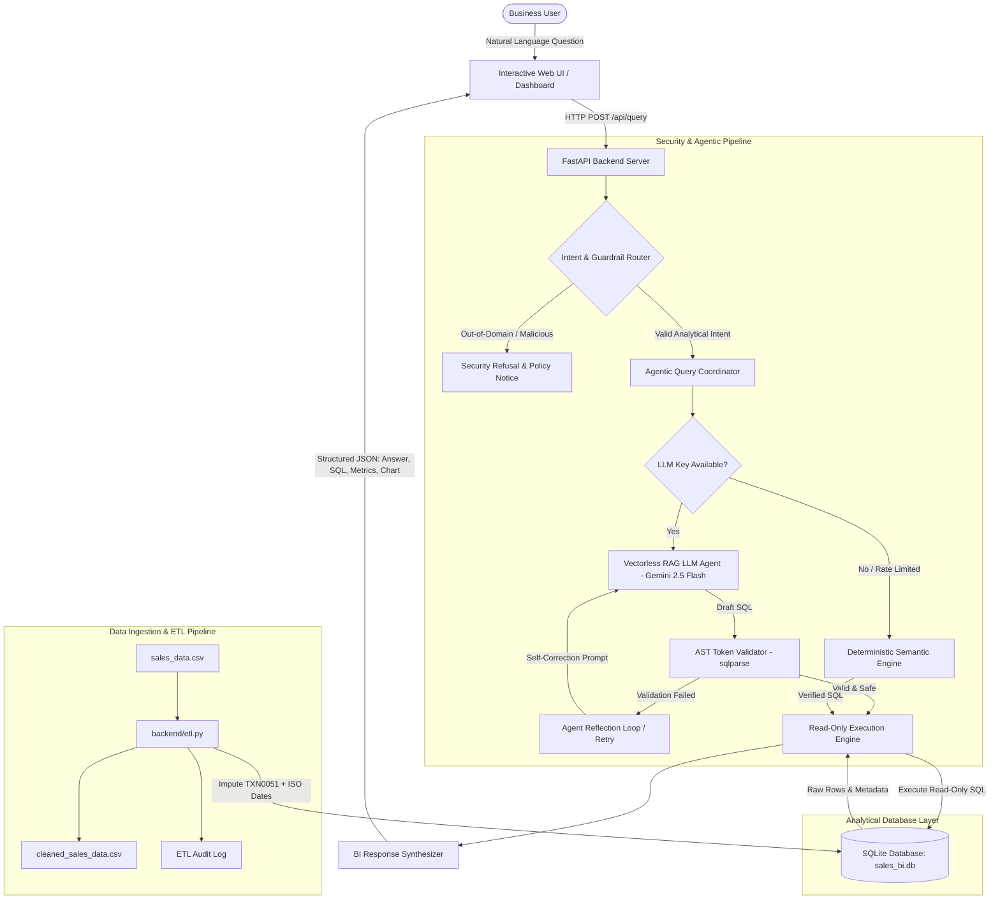

# System Architecture & Technical Specification
## Submission Deliverable: Architecture Diagram & Technical Description

**Project:** Mini AI Business Intelligence Assistant  
**Architecture Paradigm:** Vectorless RAG • AST-Validated Text-to-SQL • Read-Only Sandboxing  

---

## 1. High-Level Architecture Diagram



---

## 2. Component Deconstruction

### 1. Ingestion & Forensic ETL Pipeline (`backend/etl.py`)
- **Raw Ingestion:** Reads the 51-row transaction dataset.
- **Forensic Cleaning:**
  - Identifies `TXN0051` missing price; checks product modal catalog price (`Laptop Stand` = $1,200.00); cleanly imputes with audit logging.
  - Standardizes `DD-MM-YYYY` dates into ISO-8601 `YYYY-MM-DD`.
  - Derives `order_month` (`YYYY-MM`), `gross_revenue`, and `net_revenue`.
- **Database Loader:** Creates `sales` table in SQLite with B-tree indexes on `order_date`, `order_month`, `product`, `region`, and `status`.

### 2. Security & AST Validator (`backend/security.py`)
- Uses Python `sqlparse` to tokenize incoming SQL.
- **Rules Enforced:**
  1. `len(parsed) == 1`: Semicolon-chained multi-statement attacks are rejected.
  2. `statement.get_type() in ('SELECT', 'UNKNOWN')`: Strictly blocks DDL (`DROP`, `ALTER`, `CREATE`, `TRUNCATE`) and DML (`DELETE`, `UPDATE`, `INSERT`, `REPLACE`).
  3. Checks all flattened tokens against blacklisted keywords (`DROP`, `DELETE`, `UPDATE`, `INSERT`, `ALTER`, `EXEC`, `PRAGMA`).
  4. Enforces read-only database connection URI: `file:sales_bi.db?mode=ro`.

### 3. Agentic Query Coordinator (`backend/llm_agent.py`)
- Checks for API keys (`GEMINI_API_KEY` in `.env` or passed via UI).
- When an API key is present:
  - Injects schema and few-shot grounding into the prompt.
  - Implements an **Agentic Reflection Loop** that captures execution errors and retries up to 2 times.
  - Employs structured JSON mode (`response_mime_type="application/json"`) for reliable payload synthesis.
- When no API key is present or when rate-limited (HTTP 429):
  - Gracefully routes to the `DeterministicEngine`, guaranteeing that the system always runs with zero downtime.

### 4. Deterministic Semantic Engine (`backend/deterministic_engine.py`)
- Analyzes semantic intent for all 5 core benchmark questions.
- Formulates optimal SQL queries with sub-millisecond execution.
- Generates natural language insights, metric cards, and Chart.js visualization datasets.

### 5. Interactive Web Frontend (`frontend/`)
- Built with HTML5, Vanilla CSS, and Chart.js.
- Features:
  - 5 benchmark query quick-action chips.
  - Conversational Markdown answer card.
  - Key Metrics Grid.
  - Chart.js visualizer (bar, line, and doughnut charts).
  - SQL Inspector with syntax display and clipboard copy button.
  - Tabular supporting records table.
  - Data Health & Forensic Audit modal.

---

## 3. Data Flow & Security Boundaries

```
[ User Request ]
      |
      v  [ Boundary 1: API Gateway & Input Sanitization ]
FastAPI validates QueryRequest schema (rejects empty/oversized strings)
      |
      v  [ Boundary 2: Semantic Intent & Guardrail Router ]
Pattern & Scope Analysis -> Rejects out-of-domain questions
      |
      v  [ Boundary 3: Agentic SQL Generation & Reflection Loop ]
LLM generates candidate SQLite query grounded in schema
      |
      v  [ Boundary 4: AST Token Parser & Security Policy ]
sqlparse verifies root type is SELECT, bans DDL/DML and multi-statements
      |
      v  [ Boundary 5: SQLite Read-Only Execution Sandbox ]
Physical URI: file:sales_bi.db?mode=ro (OS and engine reject writes)
      |
      v  [ Output Stage ]
Structured JSON Response with natural language answer, metrics, and chart
```
